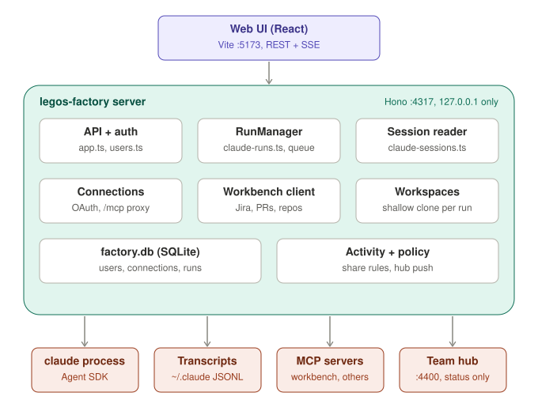

# legos-factory

Software development factory: local mission control for coding agents.

Local mission control for coding agents. v1 runtime: Claude Code. Codex and Hermes come later behind the same model (`shared/types.ts`).



- **Observe** — every Claude Code session in `~/.claude/projects` (terminal ones too): timeline, tools, errors, token buckets (deduped by message id, subagents included; unknown ≠ 0).
- **Chat** — interactive Claude Code sessions to discuss: reply between turns, stop a turn, end the session. Pick any model your account offers, switch mid-session. Idle chats close after 30 min (`LEGOS_IDLE_MS`).
- **Task** — hand off a job: one prompt, runs to completion on its own (Done / Failed / Cancelled), then "Discuss in chat" to follow up. Permissions picked per task.
- **Needs you** — permission requests and `AskUserQuestion` clarifications from all UI-launched runs in one inbox.
- **Reviews** — open PRs from others that wait on you: you're a reviewer, or someone @-mentioned you in a comment. "Review with factory" drafts a review you post yourself.
- **PR replies and Ask factory** — reply to any review comment from the PR page, or tick comments and **Ask factory**: one comment at a time, a read-only run proposes a fix, you approve (or edit, or skip), a fix run commits and pushes to the PR branch, and the factory replies on the comment with the commit. Then the next one.

- **Connections** — add workbench or any remote MCP server in Settings (OAuth or a static header); every new chat and task gets them as MCP tools.

Runs load your user/project settings, so MCP servers (Jira, Bitbucket, …) and skills work as in the CLI. Nothing org-specific lives here.

```bash
npm install
cp .env.example .env.local   # optional
npm run dev     # api :4317 + ui :5173
npm test
```

`npm run build && npm start` serves the built UI from the API port. `npm run dev:team` also starts a local team hub (`LEGOS_MODE=hub`, :4400) for My activity / Team activity.

## Notes

- Everything legos-factory owns lives in one SQLite file, `~/.legos-factory/factory.db` (0600): users, their connections and their runs.
- Sign-in, two separate kinds of user: local users (name + 6-digit PIN, scrypt; anyone at the machine can add one) and, with `LEGOS_WORKBENCH_URL` set, "Sign in with workbench" (OAuth 2.1 + PKCE; that user starts with workbench already connected). Sessions are HMAC-signed cookies for 30 days. Five wrong PINs lock a name for 30 s, doubling per further miss. `LEGOS_AUTH=off` skips sign-in for local dev.
- Each user sees only their own runs, decisions, sessions and connections. Sessions lists only conversations started here (transcripts are still read from Claude's own JSONL); terminal sessions never show up.
- Connections (Settings): a workbench or any MCP server, via OAuth 2.1 (discovery, dynamic client registration, PKCE) or a static header. Credentials stay server-side in `factory.db`, per user; runs reach each of their owner's servers through a local proxy (`/mcp/<name>`) that attaches them fresh. A connected workbench also enables the apps list, Jira tasks and the team hub.

- Reviews and Ask factory go through workbench's Bitbucket tools, which have two gaps: no threaded replies (a reply is a new comment on the same line, quoting the original) and no search for review requests (Reviews scans the 40 most recently updated open PRs across the repos you work in plus your workspace's 15 most recently updated repos, matches you by Bitbucket account id — your name comes from the Reviews page, else workbench, else your email — and caches for 5 minutes). Ask factory works on its own fresh clone of the PR branch (`pr-<id>` under the workspaces dir), so your own checkout is never touched; its shell commands (tests, commit, push) still ask in Needs you.

- Binds to 127.0.0.1 only. `/api` rejects non-local `Host` and requires `x-legos: 1` on writes, since launching a run executes code.
- Each live session is a `claude` process. Live runs are in memory; restarting the server marks the unfinished ones failed (their transcripts stay under Sessions and can be continued).
- Cost is Claude Code's API-equivalent estimate, not an invoice.
- Team sharing per folder (Private / Status / Full) and ticket detection live in `~/.legos-factory/settings.json` (`LEGOS_SETTINGS` overrides). Private unless a rule says otherwise; nothing is sent anywhere until the team hub exists.
- `CLAUDE_PROJECTS_DIR` overrides the transcripts dir; `LEGOS_API_PORT` the API port.
